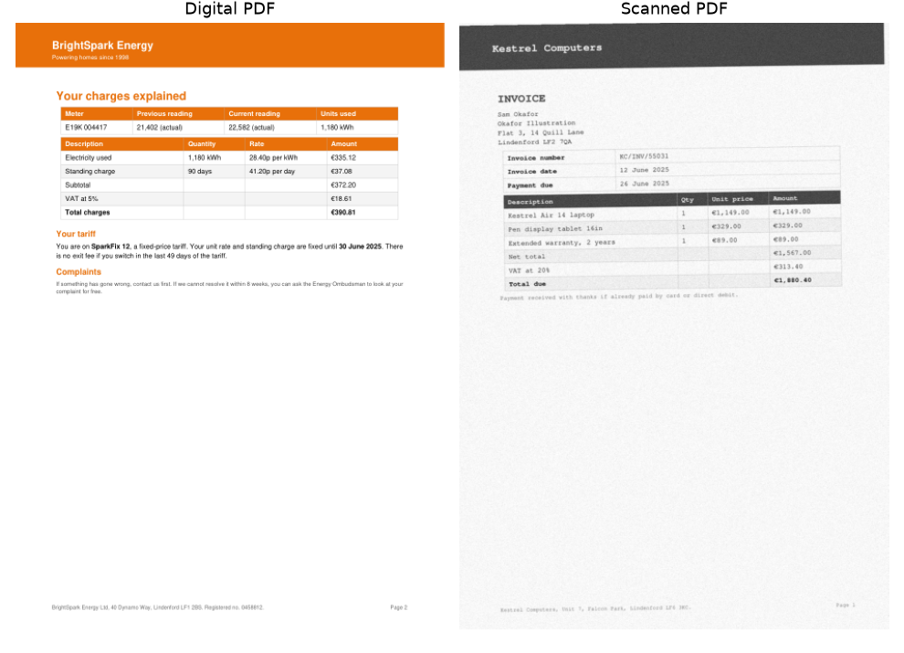
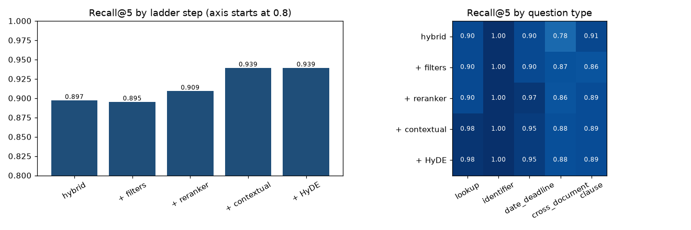

---
jupyter:
  jupytext:
    formats: ipynb,md
    text_representation:
      extension: .md
      format_name: markdown
      format_version: '1.3'
      jupytext_version: 1.19.6
  kernelspec:
    display_name: Python 3
    language: python
    name: python3
---

# Answering questions about your bills and contracts with RAG, and measuring what actually helps

Bills, invoices, contracts and insurance policies pile up as PDFs, and answering "what's the notice period on the phone contract?" or "how much did we spend on energy last year?" means opening ten files. Retrieval-augmented generation (RAG) can answer these questions with a citation to the page, but most tutorials stop at "embed, retrieve, answer" and never show whether a technique helps.

Admin documents are a hard, relatable test: exact identifiers (invoice numbers, account numbers, amounts), answers inside tables, long contract clauses, and scanned pages. This cookbook builds an assistant over a synthetic household's paperwork and then climbs a ladder of retrieval techniques, scoring every step on the same 148 questions.

By the end you'll be able to:

- **Build** an eval set with known answers and source pages, including scans and questions the documents cannot answer.
- **Compare** PDF parsers and retrieval techniques (BM25, dense, hybrid, metadata filters, reranking, contextual retrieval, HyDE) by their measured effect, not by eye.
- **Generate** cited answers with an LLM and grade them with a second model as judge, plus code-based citation and refusal checks.
- **Decide** which configuration to use for your own documents, weighing quality against latency and cost.


## Prerequisites

- **Knowledge**: comfortable with Python; you have called an LLM API before.
- **Accounts**: an [Nscale](https://console.nscale.com/auth/signup) account and a service token (Settings → Service Tokens).
- **Hardware**: a laptop with 16 GB RAM. No GPU: everything except the LLM calls runs locally on CPU.
- **Software**: Python 3.12 and Docker (for the Weaviate vector database).
- **Time and cost**: about 15 minutes for a first full run (plus model downloads) and under $1 of Nscale usage; see the cost table in section 6. Re-runs reuse cached LLM calls and cost nothing. Set `QUICK_RUN = True` for a 50-question run.

## Assumptions

- The LLMs run on Nscale serverless inference through its OpenAI-compatible API: GLM 5.3 writes answers, Qwen3.8 Flash Next does cheap bulk work (metadata extraction, chunk context, query filters, HyDE), and Mistral Large 3 is the judge. The judge is a different model from the generator, and not a weaker one.
- Embeddings (`bge-base-en-v1.5`) and the reranker (`bge-reranker-base`) run locally, so only LLM calls leave the laptop.
- Plain Python around the Weaviate client, no RAG framework, so every step stays visible.


## Setup

Install the pinned dependencies. Pinning keeps the cookbook runnable after upstream releases.

```python
%%capture
%pip install -r requirements.txt
```

Import everything once and load the Nscale service token from a `.env` file (copy `.env.example` to `.env` and paste your token).

```python
import asyncio
import collections
import difflib
import hashlib
import json
import logging
import os
import re
import sqlite3
import subprocess
import sys
import time
import warnings
from dataclasses import dataclass, replace
from datetime import date, datetime, timezone
from pathlib import Path

import matplotlib.pyplot as plt
import numpy as np
import pandas as pd
import pymupdf
from dotenv import load_dotenv
from openai import AsyncOpenAI, OpenAI

load_dotenv()
assert os.getenv("NSCALE_SERVICE_TOKEN"), "Set NSCALE_SERVICE_TOKEN in .env"
pd.set_option("display.max_colwidth", 120)

# Keep outputs readable: hide download progress bars and library deprecation chatter.
os.environ["HF_HUB_DISABLE_PROGRESS_BARS"] = "1"
os.environ["HF_HUB_VERBOSITY"] = "error"
warnings.filterwarnings("ignore", category=FutureWarning)
logging.getLogger("torch.distributed.elastic.multiprocessing.redirects").setLevel(logging.ERROR)
```

Every tunable constant lives in this one cell, with the reason for its value.

```python
NSCALE_BASE_URL = "https://inference.api.nscale.com/v1"
GENERATOR_MODEL = "zai-org/GLM-5.3"                # writes the cited answers
BULK_MODEL = "Qwen/Qwen3.8-Flash-Next-FP8"         # cheap, fast: metadata, chunk context, filters, HyDE
JUDGE_MODEL = "mistralai/Mistral-Large-3-675B-Instruct-2512-NVFP4"  # different family from the generator, not weaker
JUDGE_PROMPT_VERSION = "judge-v1"                  # bump when the judge prompt changes; old scores become incomparable
BULK_PARAMS = {"reasoning_effort": "none"}         # Qwen Flash reasons by default; bulk tasks are short and don't need it
ANSWER_MAX_TOKENS = 4000                           # GLM 5.3 reasons before answering, and reasoning counts toward this limit

EMBED_MODEL = "BAAI/bge-base-en-v1.5"   # strong English retrieval at a CPU-friendly 110M parameters
EMBED_QUERY_PREFIX = "Represent this sentence for searching relevant passages: "  # bge's recommended query instruction
RERANK_MODEL = "BAAI/bge-reranker-base"  # cross-encoder small enough for CPU
RERANK_MAX_TOKENS = 512                  # the reranker's input limit; longer pairs are truncated

CHUNK_TOKENS = 350      # small enough to stay on one topic, large enough to hold a full clause or bill table
CANDIDATES = 20         # pool the reranker re-orders; wider pools cost CPU time per query
TOP_K = 5               # chunks passed to the generator
HYBRID_ALPHA = 0.5      # 0 = pure BM25, 1 = pure vector; tuned with a sweep in section 4
AS_OF = "2026-04-01"    # "today" in the fictional world, for relative date questions

QUICK_RUN = False       # True: 50-question stratified subset, for a cheaper first run
QUICK_N = 50
LLM_CONCURRENCY = 8     # parallel Nscale requests; stays well inside serverless rate limits
SEED = 42

CACHE = Path("cache")
RESULTS = Path("results")
for p in (CACHE, RESULTS):
    p.mkdir(exist_ok=True)
```

### Nscale client and model check

Nscale's API is OpenAI-compatible, so the standard `openai` client works with a different `base_url`. The `/v1/models` endpoint lists the models your account can use and their prices; checking the configured IDs against it makes a renamed model fail loudly at the start instead of halfway through.

```python
client_kwargs = dict(api_key=os.environ["NSCALE_SERVICE_TOKEN"], base_url=NSCALE_BASE_URL)
nscale = OpenAI(**client_kwargs)
anscale = AsyncOpenAI(**client_kwargs, max_retries=5)

available = {m.id: m for m in nscale.models.list().data}
for model in (GENERATOR_MODEL, BULK_MODEL, JUDGE_MODEL):
    if model not in available:
        raise ValueError(f"{model} not available. Closest: {difflib.get_close_matches(model, available, n=3, cutoff=0.3)}")

pricing = {m: available[m].to_dict()["pricing"] for m in (GENERATOR_MODEL, BULK_MODEL, JUDGE_MODEL)}
PRICES = {m: (p["input"], p["output"]) for m, p in pricing.items()}
pd.DataFrame(PRICES, index=["$ per 1M input tokens", "$ per 1M output tokens"]).T
```

Every LLM call goes through one async function. It caches responses on disk (so re-runs are free and repeatable), records token usage and the original latency for the cost table, and strips any reasoning trace a model returns before its answer.

```python
class DiskCache:
    """A tiny key-value store in SQLite, one table per namespace."""

    def __init__(self, path):
        self.db = sqlite3.connect(path)
        self.db.execute("CREATE TABLE IF NOT EXISTS kv (key TEXT PRIMARY KEY, value TEXT)")

    def get(self, key):
        row = self.db.execute("SELECT value FROM kv WHERE key = ?", (key,)).fetchone()
        return json.loads(row[0]) if row else None

    def set(self, key, value):
        self.db.execute("INSERT OR REPLACE INTO kv VALUES (?, ?)", (key, json.dumps(value)))
        self.db.commit()


def stable_hash(*parts):
    return hashlib.sha256(json.dumps(parts, sort_keys=True, default=str).encode()).hexdigest()


llm_cache = DiskCache(CACHE / "llm.sqlite")
LEDGER = []  # one row per LLM call: stage, model, tokens, latency
semaphore = asyncio.Semaphore(LLM_CONCURRENCY)


async def llm(model, messages, stage, max_tokens=512, **params):
    """Chat completion with disk cache and usage accounting. Returns (text, latency_seconds)."""
    key = stable_hash(model, messages, max_tokens, params)
    hit = llm_cache.get(key)
    if hit is None:
        async with semaphore:
            t0 = time.perf_counter()
            resp = await anscale.chat.completions.create(
                model=model, messages=messages, temperature=0, max_tokens=max_tokens, **params)
            text = resp.choices[0].message.content or ""
            hit = {"text": re.sub(r"<think>.*?</think>", "", text, flags=re.S).strip(),
                   "prompt_tokens": resp.usage.prompt_tokens, "completion_tokens": resp.usage.completion_tokens,
                   "latency_s": time.perf_counter() - t0}
        llm_cache.set(key, hit)
    LEDGER.append({"key": key, "stage": stage, "model": model, "prompt_tokens": hit["prompt_tokens"],
                   "completion_tokens": hit["completion_tokens"], "latency_s": hit["latency_s"]})
    return hit["text"], hit["latency_s"]


def parse_json(text):
    """Pull the first JSON object out of a model reply (models sometimes wrap it in prose or fences)."""
    match = re.search(r"\{.*\}", text, flags=re.S)
    return json.loads(match.group(0)) if match else {}


def ledger_df():
    """One row per distinct call, so re-running a cell does not double-count its cost."""
    df = pd.DataFrame(LEDGER).drop_duplicates(subset=["key", "stage"])
    df["cost_usd"] = [(r.prompt_tokens * PRICES[r.model][0] + r.completion_tokens * PRICES[r.model][1]) / 1e6
                      for r in df.itertuples()]
    return df


def stage_cost(stage):
    df = ledger_df()
    return df.loc[df["stage"] == stage, "cost_usd"].sum()


text, secs = await llm(BULK_MODEL, [{"role": "user", "content": "Reply with the single word: ready"}], stage="smoke", **BULK_PARAMS)
print(text, f"({secs:.2f}s)")
```

### Start Weaviate

Weaviate is the vector database. It stores each chunk with its vector and metadata, and keeps its own BM25 keyword index, so lexical, vector and hybrid search all run against one collection. The compose file runs it with no built-in vectorizer: we compute embeddings ourselves.

```python
import weaviate
from weaviate.classes.config import Configure, DataType, Property, Tokenization
from weaviate.classes.query import Filter, HybridFusion, MetadataQuery
from weaviate.util import generate_uuid5

subprocess.run(["docker", "compose", "up", "-d"], check=True, capture_output=True)
for _ in range(30):
    try:
        wv = weaviate.connect_to_local()
        if wv.is_ready():
            break
    except Exception:
        time.sleep(2)
print("Weaviate", wv.get_meta()["version"], "ready:", wv.is_ready())
```

Load the two local models. Both download once from Hugging Face (about 1.4 GB together) and then run on CPU.

```python
import transformers
from sentence_transformers import CrossEncoder, SentenceTransformer

transformers.logging.set_verbosity_error()  # token counting on long pages triggers a harmless length warning
transformers.logging.disable_progress_bar()
embedder = SentenceTransformer(EMBED_MODEL, device="cpu")
reranker = CrossEncoder(RERANK_MODEL, max_length=RERANK_MAX_TOKENS, device="cpu")
tokenizer = embedder.tokenizer
print(EMBED_MODEL, embedder.get_embedding_dimension(), "dimensions;", RERANK_MODEL, "loaded")
```

## 1. Build the dataset

**Concept.** You cannot tell whether a RAG change helps without questions whose answers you already know. Public benchmarks rarely look like your documents, and hand-labelling real paperwork is slow and leaks personal data. A synthetic corpus generated from one source file solves both: every fact in every document comes from that file, so every question's answer and the exact page it appears on are known by construction. The risk is that synthetic documents are too clean, so vary layouts, include scans, and add questions the documents cannot answer. See [Anthropic's guide to building evals](https://docs.anthropic.com/en/docs/test-and-evaluate/develop-tests) for the general approach.

**What we do here.** `world.yaml` describes a fictional household: Robin Marlowe and Sam Okafor, who works as a freelance illustrator. It lists their energy, water and phone suppliers, Sam's client and supplier invoices, five contracts and two letters over January 2025 to March 2026. `generate_corpus.py` renders 46 PDFs with ReportLab, each vendor with its own layout, turns 9 of them into degraded image-only scans, and writes 148 questions with the pages that hold each answer.

```python
subprocess.run([sys.executable, "generate_corpus.py"], check=True)
DOCS = {d["doc_id"]: d for d in map(json.loads, Path("corpus/documents.jsonl").read_text().splitlines())}
QUESTIONS = [json.loads(line) for line in Path("questions.jsonl").read_text().splitlines()]

docs_df = pd.DataFrame(DOCS.values())
docs_df.groupby("doc_type").agg(documents=("doc_id", "count"), pages=("pages", "sum"), scanned=("scanned", "sum"))
```

**What we see.** The corpus has 46 documents and 65 pages. Utility bills (13) and issued invoices (12) dominate, as they would in a real household with a freelancer in it. The 9 scans are spread across water bills, supplier invoices, both letters and the car insurance policy, so OCR quality affects several question types, not just one.

Here is what a clean page and a scanned page look like. The scan is rotated slightly, blurred and noisy, with no text layer, so it can only be read with OCR.

```python
def render(doc_id, page=0, dpi=55):
    pix = pymupdf.open(DOCS[doc_id]["file"])[page].get_pixmap(dpi=dpi)
    return np.frombuffer(pix.samples, dtype=np.uint8).reshape(pix.height, pix.width, pix.n)

fig, axes = plt.subplots(1, 2, figsize=(9, 6.5))
for ax, (doc_id, page, title) in zip(axes, [("elec-2025-q1", 1, "Digital PDF"), ("sinv-kc-inv-55031", 0, "Scanned PDF")]):
    ax.imshow(render(doc_id, page), cmap="gray")
    ax.set_title(title)
    ax.axis("off")
fig.tight_layout()
fig.savefig(RESULTS / "sample_pages.png", dpi=110)
plt.close(fig)
```



Each question records its type and its *evidence*: the facts the answer needs, each with the pages where that fact is printed. A bill total printed on both the summary page and the breakdown page counts as found if either page is retrieved. A cross-document question such as "total electricity spend in 2025" needs four facts from four bills.

```python
def page_kind(q):
    """Which kind of page holds the evidence: scanned, table-heavy (bills, invoices) or running text."""
    if not q["evidence"]:
        return "none"
    doc = DOCS[q["evidence"][0][0][0]]
    if doc["scanned"]:
        return "scanned"
    return "table" if doc["doc_type"] in {"utility_bill", "phone_bill", "invoice_issued", "invoice_received"} else "text"


for q in QUESTIONS:
    q["page_kind"] = page_kind(q)

q_df = pd.DataFrame(QUESTIONS)
print(q_df.groupby("type").size().to_string())
q_df.groupby("type").head(1)[["type", "question", "answer", "evidence"]]
```

**What we see.** The 148 questions are 48 lookups, 35 clause questions, 19 cross-document, 17 identifier, 13 date and deadline, and 16 unanswerable. The `evidence` column shows the structure: the SparkFix 24 tariff end date is printed on three bills, so any one of them counts, while the 2025 electricity total needs four separate bills.

The benchmark scores retrieval only on answerable questions; the unanswerable ones are used in section 5 to test refusals. `QUICK_RUN` keeps a fixed, stratified 50-question sample so its numbers stay comparable between runs.

```python
if QUICK_RUN:
    EVAL_QS = q_df.groupby("type").sample(frac=QUICK_N / len(q_df), random_state=SEED).to_dict("records")
else:
    EVAL_QS = QUESTIONS
ANSWERABLE = [q for q in EVAL_QS if q["type"] != "unanswerable"]
print(len(EVAL_QS), "questions,", len(ANSWERABLE), "answerable")
```

> **Adapt it:** to use your own documents, replace the generator with a folder of PDFs and write 50 to 100 questions by hand, each with the file and page that answers it. That labelling is the most valuable hour you will spend on the project.

## 2. Parse the PDFs

**Concept.** Parsing turns a PDF into text a retriever can index. Digital PDFs have a text layer, but its reading order, table structure and headers are often scrambled; scans have no text at all and need OCR. Parsers range from fast text extractors to layout models that detect headings and rebuild tables. Parsing errors cap quality more than any later tuning, yet parsers that look very different often retrieve about equally well, so the honest test is to run each parser's output through the same retrieval pipeline and score it on the eval set. The [Docling technical report](https://arxiv.org/abs/2408.09869) describes what a layout-aware parser does differently. Run OCR only on pages that need it: on digital pages it is slower and can add errors.

**What we do here.** We compare two parsers that both output Markdown. [PyMuPDF4LLM](https://pymupdf.readthedocs.io/en/latest/pymupdf4llm/) is a fast extractor that detects tables and runs OCR automatically on image-only pages. [Docling](https://docling-project.github.io/docling/) runs layout and table-structure models on every page. Both use the same OCR engine, RapidOCR, so the comparison measures the parser rather than the OCR. Each parser produces one Markdown string per page, so every chunk later knows its exact page.

```python
import pymupdf4llm
from docling.datamodel.base_models import InputFormat
from docling.datamodel.pipeline_options import PdfPipelineOptions, RapidOcrOptions
from docling.document_converter import DocumentConverter, PdfFormatOption

docling_converter = DocumentConverter(format_options={InputFormat.PDF: PdfFormatOption(
    pipeline_options=PdfPipelineOptions(do_ocr=True, do_table_structure=True, ocr_options=RapidOcrOptions()))})


def parse_pymupdf(path):
    return [p["text"] for p in pymupdf4llm.to_markdown(path, page_chunks=True, show_progress=False)]


def parse_docling(path):
    doc = docling_converter.convert(path).document
    return [doc.export_to_markdown(page_no=n) for n in sorted(doc.pages)]


PARSERS = {"pymupdf": parse_pymupdf, "docling": parse_docling}
```

Parsing is the slowest local step, so results are cached per document and parser. The timing table reports seconds per page from the first, uncached run.

```python
def parse_all(parser):
    out_dir = CACHE / "parsed" / parser
    out_dir.mkdir(parents=True, exist_ok=True)
    parsed = {}
    for doc_id, doc in DOCS.items():
        path = out_dir / f"{doc_id}.json"
        if not path.exists():
            t0 = time.perf_counter()
            pages = PARSERS[parser](doc["file"])
            path.write_text(json.dumps({"pages": pages, "seconds": time.perf_counter() - t0}))
        parsed[doc_id] = json.loads(path.read_text())
    return parsed


PARSED = {name: parse_all(name) for name in PARSERS}

timing = []
for name, parsed in PARSED.items():
    for scanned in (False, True):
        ids = [d for d in DOCS if DOCS[d]["scanned"] == scanned]
        secs = sum(parsed[d]["seconds"] for d in ids)
        timing.append({"parser": name, "pages": "scanned" if scanned else "digital",
                       "seconds_per_page": round(secs / sum(DOCS[d]["pages"] for d in ids), 2)})
pd.DataFrame(timing).pivot(index="parser", columns="pages", values="seconds_per_page")
```

**What we see.** PyMuPDF4LLM parses a digital page in 0.12 s against Docling's 0.58 s, about five times faster. Both slow down on scans, where OCR runs (1.1 s and 1.9 s per page). At this corpus size either parser finishes in about a minute, so speed is not the deciding factor here; at 10,000 pages it would be.

Look at the same table page through both parsers before trusting either. This is page 2 of the first electricity bill, which holds the meter readings and the charges table.

```python
for name in PARSERS:
    print(f"===== {name} =====")
    print(PARSED[name]["elec-2025-q1"]["pages"][1][:900], "\n")
```

**What we see.** The two outputs differ visibly. PyMuPDF4LLM keeps both tables clean, header rows included, and keeps the coloured page header with the vendor name, *BrightSpark Energy*. Docling merges the two adjacent tables into one, duplicates columns, and drops the page header as page furniture, so this page's text never names the vendor. Which matters more for retrieval cannot be judged by eye; section 4 measures it.

> **Adapt it:** for a larger corpus, parse in parallel. The optional cell below spreads Docling over your CPU cores with [Ray Data](https://docs.ray.io/en/latest/data/data.html); the same code scales to a cluster.

```python
USE_RAY = False  # parsing 65 pages serially takes a few minutes; Ray pays off from a few hundred pages

if USE_RAY:
    import ray

    ray.init(ignore_reinit_error=True)
    files = ray.data.from_items([{"doc_id": d, "file": DOCS[d]["file"]} for d in DOCS])
    parsed_rows = files.map(lambda r: {"doc_id": r["doc_id"], "pages": parse_docling(r["file"])}).take_all()
    print(len(parsed_rows), "documents parsed with Ray")
```

## 3. Extract metadata, chunk and index

### Metadata extraction

**Concept.** Many admin questions are really filters: "the March electricity bill" means document type, vendor and date first, similarity second. Metadata such as document type, issuer, date, the period a bill covers and reference numbers is what makes those filters possible. Real pipelines rarely get it for free; it is extracted from the document, by rules or by an LLM, and extraction errors become retrieval errors. Measure extraction accuracy on a labelled sample so you know how far to trust the filters.

**What we do here.** Qwen3.8 Flash Next reads the first page of each document (as parsed by each parser) and returns JSON with document type, vendor, counterparty, document date, billing period and reference. We score each field against the generator's ground truth.

```python
DOC_TYPES = ["utility_bill", "phone_bill", "invoice_issued", "invoice_received", "contract", "lease", "insurance_policy", "letter"]

METADATA_PROMPT = """Extract metadata from the first page of an administrative document belonging to the household of
Robin Marlowe and Sam Okafor (Sam trades as Okafor Illustration).

Return only JSON with these keys:
- doc_type: one of {doc_types}. invoice_issued = an invoice from Okafor Illustration to a client; invoice_received = an invoice to Sam or Okafor Illustration from a supplier.
- vendor: the company or organisation that issued the document, as printed.
- counterparty: for invoices, the business being billed; otherwise null.
- doc_date: the date of the bill, invoice, statement, letter or document (YYYY-MM-DD).
- period_start, period_end: the period a bill or statement covers (YYYY-MM-DD), otherwise null.
- reference: the main account, invoice, policy or agreement number, otherwise null.

<page>
{page}
</page>"""


async def extract_metadata(parser, doc_id):
    page = PARSED[parser][doc_id]["pages"][0]
    prompt = METADATA_PROMPT.format(doc_types=", ".join(DOC_TYPES), page=page[:6000])
    text, _ = await llm(BULK_MODEL, [{"role": "user", "content": prompt}], stage="index_metadata", max_tokens=300, **BULK_PARAMS)
    return doc_id, parse_json(text)


META = {}
for parser in PARSERS:
    META[parser] = dict(await asyncio.gather(*(extract_metadata(parser, d) for d in DOCS)))
```

Vendor names come back in slightly different forms ("BrightSpark Energy Ltd" vs "BrightSpark Energy"), so we compare them after folding case, punctuation and company suffixes.

```python
def norm(s):
    s = re.sub(r"[^a-z0-9 ]", " ", str(s or "").lower().replace("&", "and"))
    return re.sub(r"\b(ltd|plc|bv|inc|limited|company|co)\b", "", s).split()


def same(a, b):
    a, b = norm(a), norm(b)
    return bool(a) and bool(b) and (set(a) <= set(b) or set(b) <= set(a))


fields = ["doc_type", "vendor", "doc_date", "period_start", "period_end", "reference"]
accuracy = {}
for parser in PARSERS:
    scores = collections.defaultdict(list)
    for doc_id, truth in DOCS.items():
        pred = META[parser][doc_id]
        for f in fields:
            if f == "vendor":
                scores[f].append(same(pred.get(f), truth[f]))
            else:
                scores[f].append(str(pred.get(f) or "") == str(truth[f] or ""))
    accuracy[parser] = {f: np.mean(v) for f, v in scores.items()}
pd.DataFrame(accuracy).T.round(2)
```

**What we see.** From PyMuPDF4LLM's text, the LLM gets the vendor right for every document (1.00); from Docling's text, only 0.70. That is the dropped page header from the previous cell turning into a metadata error. Document dates and reference numbers are extracted perfectly from both. The weakest fields are the billing period start and end (0.87 to 0.89). Those errors flow straight into the date filters in section 4.

### Chunking

**Concept.** Chunking splits documents into the units the retriever returns. Fixed-size windows are simple but cut tables and clauses in half; structure-aware splitting follows headings, paragraphs and tables, so each chunk covers one topic. Tables need special care: the answer to "how much was the standing charge?" is a row whose meaning depends on the header, so keep tables whole and repeat the header if a table must be split. Start with a few hundred tokens per chunk and tune against the eval set; see [Pinecone's chunking guide](https://www.pinecone.io/learn/chunking-strategies/) for the options.

**What we do here.** Each page's Markdown is split into sections at headings. Sections are packed together up to 350 tokens (counted with the embedding model's own tokenizer), tables are never split unless they exceed the limit, and chunks never cross pages, so each chunk has one exact page number. Every chunk carries the metadata extracted above.

```python
def n_tokens(text):
    return len(tokenizer.tokenize(text))


def blocks(markdown):
    """Split Markdown into blocks: headings, whole tables, and paragraphs."""
    out, table = [], []
    for para in re.split(r"\n\s*\n", markdown):
        lines = [l for l in para.strip().splitlines() if l.strip()]
        if not lines:
            continue
        if all(l.lstrip().startswith("|") for l in lines):
            table += lines
            continue
        if table:
            out.append("\n".join(table))
            table = []
        out.append("\n".join(lines))
    if table:
        out.append("\n".join(table))
    return out


def split_table(table):
    """Split an over-long table by rows, repeating the header so every piece stays readable."""
    lines = table.splitlines()
    header, rows, pieces, cur = lines[:2], lines[2:], [], []
    for row in rows:
        if cur and n_tokens("\n".join(header + cur + [row])) > CHUNK_TOKENS:
            pieces.append("\n".join(header + cur))
            cur = []
        cur.append(row)
    return pieces + ["\n".join(header + cur)]


def chunk_page(markdown):
    sections, cur = [], []
    for b in blocks(markdown):
        if b.startswith("#") and cur:
            sections.append(cur)
            cur = []
        cur.append(b)
    if cur:
        sections.append(cur)

    chunks, buf = [], []

    def add(piece):
        """Append to the current chunk, starting a new one if the limit would be exceeded."""
        if buf and n_tokens("\n\n".join(buf + [piece])) > CHUNK_TOKENS:
            chunks.append("\n\n".join(buf))
            buf.clear()
        buf.append(piece)

    for section in sections:
        whole = "\n\n".join(section)
        if n_tokens(whole) <= CHUNK_TOKENS:  # keep a section together whenever it fits
            add(whole)
            continue
        for b in section:  # an oversized section is packed block by block
            if b.startswith("|") and n_tokens(b) > CHUNK_TOKENS:
                for piece in split_table(b):
                    add(piece)
            else:
                add(b)
    if buf:
        chunks.append("\n\n".join(buf))
    return [c for c in chunks if c.strip()]
```

Build the chunk records for both parsers. Dates are stored as datetimes so Weaviate can filter on ranges; documents without a billing period use their document date as a one-day period, so one overlap filter covers bills, invoices and contracts.

```python
def to_dt(s):
    try:
        return datetime.fromisoformat(str(s)[:10]).replace(tzinfo=timezone.utc)
    except ValueError:
        return None


def build_chunks(parser):
    chunks = []
    for doc_id, parsed in PARSED[parser].items():
        m = META[parser][doc_id]
        doc_date = to_dt(m.get("doc_date"))
        for page_no, md in enumerate(parsed["pages"], start=1):
            for i, text in enumerate(chunk_page(md)):
                chunks.append({
                    "chunk_id": f"{doc_id}:p{page_no}:c{i}", "doc_id": doc_id, "page": page_no,
                    "text": text, "search_text": text,
                    "doc_type": m.get("doc_type") or "unknown", "vendor": m.get("vendor") or "unknown",
                    "counterparty": m.get("counterparty") or "", "reference": m.get("reference") or "",
                    "doc_date": doc_date,
                    "period_start": to_dt(m.get("period_start")) or doc_date,
                    "period_end": to_dt(m.get("period_end")) or doc_date})
    return chunks


CHUNKS = {parser: build_chunks(parser) for parser in PARSERS}
for parser, chunks in CHUNKS.items():
    sizes = [n_tokens(c["text"]) for c in chunks]
    print(f"{parser}: {len(chunks)} chunks, median {int(np.median(sizes))} tokens, max {max(sizes)}")

example = next(c for c in CHUNKS["docling"] if c["doc_id"] == "contract-nimbus" and "notice" in c["text"])
print({k: example[k] for k in ("chunk_id", "doc_type", "vendor", "doc_date")})
print(example["text"][:700])
```

**What we see.** PyMuPDF4LLM's pages give 78 chunks and Docling's 93, with a median of about 265 tokens and none over the 350 limit. The example is clause 9 of the Nimbus contract, complete with its heading. Its metadata carries the vendor as the LLM extracted it ("Nimbus Telecom Ltd") and the document date.

### Contextual chunks

**Concept.** A chunk that says "The minimum term is 24 months" does not say which contract it belongs to, so neither BM25 nor an embedding can link it to "phone contract". [Contextual retrieval](https://www.anthropic.com/news/contextual-retrieval) asks an LLM to write a sentence or two situating each chunk in its document (type, issuer, date, subject) and prepends it before indexing. Anthropic reported about 35% fewer retrieval failures from contextual embeddings alone and 49% with contextual BM25 as well. The cost is one LLM call per chunk at indexing time, paid once.

**What we do here.** Qwen3.8 Flash Next sees the whole document (our documents are at most two pages) plus the chunk, and writes at most 50 words of context. The context is added to the text that gets embedded and BM25-indexed; the generator still sees only the original chunk. We build contextual chunks for both parsers, since the parser comparison comes later; section 4 shows whether they help.

```python
CONTEXT_PROMPT = """<document>
{document}
</document>
Here is a chunk from the document above:
<chunk>
{chunk}
</chunk>
Write a short context (at most 50 words) that situates this chunk within the document, to improve search
retrieval of the chunk. Mention the document type, who issued it, the date or period, and any reference
number. Answer only with the context."""


async def contextualise(parser, chunk):
    document = "\n\n".join(PARSED[parser][chunk["doc_id"]]["pages"])
    prompt = CONTEXT_PROMPT.format(document=document[:12000], chunk=chunk["text"])
    context, _ = await llm(BULK_MODEL, [{"role": "user", "content": prompt}], stage="index_context", max_tokens=120, **BULK_PARAMS)
    return {**chunk, "search_text": f"{context}\n\n{chunk['text']}"}


for parser in PARSERS:
    CHUNKS[f"{parser}_ctx"] = await asyncio.gather(*(contextualise(parser, c) for c in CHUNKS[parser]))
print(next(c for c in CHUNKS["docling_ctx"] if c["doc_id"] == "contract-nimbus")["search_text"][:500])
```

**What we see.** The generated context names the document type, the reference number, the date and what the chunk covers: everything the bare chunk lacks. One such sentence is written for each of the 171 chunks across both parsers.

### Embed and index

**Concept.** An embedding model maps text to a vector so that texts with similar meaning sit close together; the vector database finds the nearest chunks to a query vector. Smaller models are faster on CPU at some cost in quality; whichever you choose, use the same model for chunks and queries, and cache vectors so re-runs do not re-embed. Store the metadata next to the vector so search can filter on it. Exact-match fields such as vendor and document type should be indexed as whole values, not split into words.

**What we do here.** `bge-base-en-v1.5` embeds chunks, and questions with its query instruction prepended. Each parser gets one Weaviate collection with plain chunks and one with contextual chunks. BM25 runs over `search_text`; metadata fields use field tokenization so filters match whole values.

```python
emb_cache = DiskCache(CACHE / "embeddings.sqlite")


def embed(texts):
    """Embed passages with a disk cache keyed by model and text."""
    keys = [stable_hash(EMBED_MODEL, t) for t in texts]
    cached = [emb_cache.get(k) for k in keys]
    todo = [i for i, v in enumerate(cached) if v is None]
    if todo:
        vectors = embedder.encode([texts[i] for i in todo], normalize_embeddings=True, batch_size=32)
        for i, v in zip(todo, vectors):
            cached[i] = v.tolist()
            emb_cache.set(keys[i], cached[i])
    return np.array(cached)


def create_collection(name, chunks):
    if wv.collections.exists(name):
        wv.collections.delete(name)
    exact = dict(data_type=DataType.TEXT, tokenization=Tokenization.FIELD, index_searchable=False)
    coll = wv.collections.create(
        name,
        vector_config=Configure.Vectors.self_provided(),
        properties=[
            Property(name="search_text", data_type=DataType.TEXT),
            Property(name="text", data_type=DataType.TEXT, index_searchable=False),
            Property(name="chunk_id", **exact), Property(name="doc_id", **exact),
            Property(name="doc_type", **exact), Property(name="vendor", **exact),
            Property(name="counterparty", **exact), Property(name="reference", **exact),
            Property(name="page", data_type=DataType.INT),
            Property(name="doc_date", data_type=DataType.DATE),
            Property(name="period_start", data_type=DataType.DATE),
            Property(name="period_end", data_type=DataType.DATE)])
    vectors = embed([c["search_text"] for c in chunks])
    with coll.batch.fixed_size(batch_size=100) as batch:
        for c, v in zip(chunks, vectors):
            # A UUID derived from the chunk ID keeps tie-breaking between equal scores identical across rebuilds.
            batch.add_object(properties={k: v_ for k, v_ in c.items() if v_ is not None}, vector=v.tolist(),
                             uuid=generate_uuid5(c["chunk_id"]))
    return coll


t0 = time.perf_counter()
COLLECTIONS = {name: create_collection(f"Chunks_{name}", chunks) for name, chunks in CHUNKS.items()}
print({name: len(coll) for name, coll in COLLECTIONS.items()}, f"in {time.perf_counter() - t0:.0f}s")
```

**What we see.** Four collections, plain and contextual for each parser (78 and 93 chunks), are embedded and loaded in about 15 seconds on CPU. A re-run takes less, since vectors come from the cache.

## 4. The retrieval ladder

**Concept.** Retrieval quality is measured against labelled evidence. *Recall@k* is the share of the evidence a question needs that appears among the top k chunks; *MRR* (mean reciprocal rank) rewards putting the first relevant chunk near the top. Report both per question type, because a technique that helps paraphrased clause questions can hurt exact identifier lookups. Change one thing at a time and keep every other setting fixed, so each gain or loss has one cause.

**What we do here.** Every configuration is a small dataclass, and one `retrieve()` function implements all of them. Each run replays all answerable questions and records Recall@5, Recall@10, MRR and latency, including any LLM call the configuration makes per query.

```python
@dataclass(frozen=True)
class RetrievalConfig:
    name: str
    index: str = "docling"     # which collection: docling, pymupdf, or either with _ctx
    mode: str = "hybrid"       # bm25, dense or hybrid
    alpha: float = HYBRID_ALPHA
    filters: bool = False
    rerank: bool = False
    hyde: bool = False


def search(cfg, query, vector, flt, limit):
    coll = COLLECTIONS[cfg.index]
    kw = dict(limit=limit, filters=flt, return_metadata=MetadataQuery(score=True))
    if cfg.mode == "bm25":
        res = coll.query.bm25(query=query, query_properties=["search_text"], **kw)
    elif cfg.mode == "dense":
        res = coll.query.near_vector(near_vector=vector, **kw)
    else:
        res = coll.query.hybrid(query=query, vector=vector, alpha=cfg.alpha, query_properties=["search_text"],
                                fusion_type=HybridFusion.RANKED, **kw)
    return [o.properties for o in res.objects]


def retrieval_metrics(hits, evidence):
    pages = [(h["doc_id"], h["page"]) for h in hits]
    facts = [{tuple(p) for p in alternatives} for alternatives in evidence]
    out = {f"recall@{k}": np.mean([bool(f & set(pages[:k])) for f in facts]) for k in (5, 10)}
    gold = set().union(*facts)
    out["mrr"] = next((1 / (i + 1) for i, p in enumerate(pages) if p in gold), 0.0)
    return out
```

These two functions run a configuration over the question set and summarise it. Per-query LLM cost comes from the ledger rows the configuration adds.

```python
RUNS = {}  # config name -> per-question DataFrame


def run(cfg, questions=None):
    questions = questions or ANSWERABLE
    rows = []
    for q in questions:
        hits, secs = retrieve(q, cfg)
        rows.append({"config": cfg.name, "qid": q["qid"], "type": q["type"], "page_kind": q["page_kind"],
                     "latency_s": secs, **retrieval_metrics(hits, q["evidence"])})
    RUNS[cfg.name] = pd.DataFrame(rows)
    return RUNS[cfg.name]


def summary(names=None):
    df = pd.concat([RUNS[n] for n in (names or RUNS)])
    out = df.groupby("config", sort=False).agg(**{"recall@5": ("recall@5", "mean"), "recall@10": ("recall@10", "mean"),
                                                 "mrr": ("mrr", "mean"), "latency_p50_s": ("latency_s", "median")})
    return out.round(3)


def by_type(names=None, column="type"):
    df = pd.concat([RUNS[n] for n in (names or RUNS)])
    return df.pivot_table(index="config", columns=column, values="recall@5", sort=False).round(2)
```

### Steps 1 to 3: BM25, dense and hybrid

**Concept.** BM25 scores chunks by overlapping words, weighting rare words heavily, so it excels at exact strings: invoice numbers, account numbers, amounts. Dense retrieval compares embeddings, so it matches paraphrases ("cancel" vs "end the agreement") but blurs exact identifiers. Hybrid search runs both and fuses the rankings; reciprocal rank fusion (RRF) adds up 1/(rank + 60) from each list, so a chunk ranked well by either method rises. It is usually the strongest single-stage baseline for documents full of codes and numbers.

**What we do here.** We run all three on both parsers' indexes. That gives the parser comparison at the same time: the parser that retrieves better carries forward to the next steps.

```python
query_vectors = {}  # qid -> (vector, seconds it took to embed the first time)


def retrieve(q, cfg):
    """Return the top 10 chunks for a question and the seconds it took, including embedding and LLM calls."""
    t0, llm_secs = time.perf_counter(), 0.0
    if q["qid"] not in query_vectors:
        t_embed = time.perf_counter()
        vector = embedder.encode([EMBED_QUERY_PREFIX + q["question"]], normalize_embeddings=True)[0]  # uncached: real latency
        query_vectors[q["qid"]] = (vector, time.perf_counter() - t_embed)
    vector, embed_secs = query_vectors[q["qid"]]
    if cfg.mode != "bm25":
        llm_secs += embed_secs  # charge every vector search for its query embedding, even when cached
    if cfg.hyde:
        passage, llm_secs_hyde = HYDE[q["qid"]]
        vector, llm_secs = embed([passage])[0], llm_secs + llm_secs_hyde
    flt = None
    if cfg.filters:
        filters, llm_secs_flt = QUERY_FILTERS[q["qid"]]
        flt, llm_secs = build_filter(filters), llm_secs + llm_secs_flt
    limit = CANDIDATES if cfg.rerank else 10
    hits = search(cfg, q["question"], vector, flt, limit)
    if flt is not None and len(hits) < TOP_K:  # filters too narrow: fall back to an unfiltered search
        hits = search(cfg, q["question"], vector, None, limit)
    if cfg.rerank:
        scores = reranker.predict([(q["question"], h["search_text"]) for h in hits], batch_size=CANDIDATES)
        hits = [hits[i] for i in np.argsort(-scores)]
    return hits[:10], time.perf_counter() - t0 + llm_secs


for index in PARSERS:
    for mode in ("bm25", "dense", "hybrid"):
        run(RetrievalConfig(f"{mode} [{index}]", index=index, mode=mode))

PARSER_PICK = max(PARSERS, key=lambda p: RUNS[f"hybrid [{p}]"]["recall@5"].mean())
print("Parser carried forward:", PARSER_PICK)
summary()
```

**What we see.** BM25 alone is the strongest single method on this corpus (Recall@5 0.893 on PyMuPDF4LLM), ahead of hybrid at the default alpha of 0.5 (0.877) and well ahead of dense retrieval (0.753). Dense catches up at Recall@10 (0.940): it finds the evidence but ranks it lower, which its MRR of 0.654 confirms. PyMuPDF4LLM beats Docling with BM25 and hybrid search, so it is the parser carried forward. Every method answers in about 15 ms.

Split by question type, the strengths of each method show up.

```python
by_type([f"{m} [{PARSER_PICK}]" for m in ("bm25", "dense", "hybrid")])
```

**What we see.** Identifier questions explain most of the gap: BM25 finds every one (1.00), dense retrieval fewer than half (0.47), because a string like `OKI-2025-007` carries no meaning for an embedding. Dense retrieval wins where wording is paraphrased, on clause (0.91 vs 0.89) and cross-document questions (0.77 vs 0.74). Hybrid search gets the best of both on clauses (0.94) and cross-document questions (0.85), but at alpha 0.5 it gives back a quarter of the identifier hits (0.76).

And split by the kind of page the evidence sits on, the parsers differ where you would expect: on tables and scans.

```python
by_type([f"hybrid [{p}]" for p in PARSERS], column="page_kind")
```

**What we see.** PyMuPDF4LLM is ahead on all three kinds of page: tables (0.81 vs 0.78), scans (0.99 vs 0.96) and running text (0.92 vs 0.90). Table pages are the hardest for both, because bills from one vendor have near-identical tables and the right quarter competes with four look-alikes. The parser choice moves the numbers by 2 to 3 points, far less than the choice of retrieval method. That matches published parser benchmarks.

### Tuning hybrid alpha

`alpha` sets the balance between BM25 (0) and vector search (1). A quick sweep costs nothing but CPU time.

```python
for alpha in (0.0, 0.25, 0.5, 0.75, 1.0):
    run(RetrievalConfig(f"hybrid a={alpha}", index=PARSER_PICK, alpha=alpha))
sweep = summary([f"hybrid a={a}" for a in (0.0, 0.25, 0.5, 0.75, 1.0)])
BEST_ALPHA = float(sweep["recall@5"].idxmax().split("=")[1])
sweep
```

**What we see.** Recall@5 peaks at alpha 0.25 (0.897), mostly BM25 with a little vector signal. Raising alpha improves Recall@10 (up to 0.957 at alpha 0.5) but pushes the best chunk down the list: MRR falls from 0.85 to 0.65. Alpha 0.25 carries forward as the `hybrid` baseline.

### Step 4: metadata filters

**Concept.** A filter removes chunks that cannot be relevant before ranking: only electricity bills, only documents covering March 2025. For admin documents this often matters more than any ranking improvement, because many bills share almost identical wording and differ only in period and vendor. Filters can come from UI controls or from an LLM that reads the question and fills a small schema with values that exist in the index. The risk is over-filtering: a wrong vendor or date removes the right answer entirely, so fall back to an unfiltered search when a filter returns too little.

**What we do here.** Qwen3.8 Flash Next reads each question and returns document type, vendor and a date range, choosing only from values present in the index. Dates filter on overlap with each document's period. If a filtered search returns fewer than 5 chunks, we search again without filters.

```python
VENDORS = sorted({c["vendor"] for c in CHUNKS[PARSER_PICK]} | {c["counterparty"] for c in CHUNKS[PARSER_PICK]} - {""})

FILTER_PROMPT = """Today is {as_of}. A user asks about their household and small-business paperwork.
Choose metadata filters that narrow the search to the documents that answer the question.

Allowed doc_type values: {doc_types}
Allowed vendor values (issuers or invoice customers): {vendors}

Return only JSON: {{"doc_type": value or null, "vendor": value or null, "date_from": "YYYY-MM-DD" or null, "date_to": "YYYY-MM-DD" or null}}
Rules: set a field only when the question clearly implies it. Set dates only when the question asks about documents
covering a specific month, quarter or year (for example bills or invoices); leave dates null for questions about
contract terms, policies or deadlines. When unsure, use null.

Question: {question}"""


async def query_filters(q):
    prompt = FILTER_PROMPT.format(as_of=AS_OF, doc_types=DOC_TYPES, vendors=VENDORS, question=q["question"])
    text, secs = await llm(BULK_MODEL, [{"role": "user", "content": prompt}], stage="query_filters", max_tokens=120, **BULK_PARAMS)
    return q["qid"], (parse_json(text), secs)


def build_filter(f):
    parts = []
    if f.get("doc_type") in DOC_TYPES:
        parts.append(Filter.by_property("doc_type").equal(f["doc_type"]))
    if f.get("vendor") in VENDORS:
        parts.append(Filter.by_property("vendor").equal(f["vendor"]) | Filter.by_property("counterparty").equal(f["vendor"]))
    lo, hi = to_dt(f.get("date_from")), to_dt(f.get("date_to"))
    if lo and hi:
        parts += [Filter.by_property("period_end").greater_or_equal(lo), Filter.by_property("period_start").less_or_equal(hi)]
    return Filter.all_of(parts) if parts else None


QUERY_FILTERS = dict(await asyncio.gather(*(query_filters(q) for q in EVAL_QS)))
example = next(q for q in ANSWERABLE if "electricity bill" in q["question"])
print(example["question"], "->", QUERY_FILTERS[example["qid"]][0])

base = RetrievalConfig("hybrid", index=PARSER_PICK, alpha=BEST_ALPHA)
LADDER = [base, replace(base, name="+ filters", filters=True)]
for cfg in LADDER:
    run(cfg)
summary([c.name for c in LADDER])
```

**What we see.** The filter LLM does the right thing on the example: utility bill, BrightSpark Energy, January to March 2025. Overall, though, filters do not help: Recall@5 moves from 0.897 to 0.895 and Recall@10 drops from 0.940 to 0.925. They cost about 0.4 s per query for the extra LLM call. The per-type table below shows why: filters help cross-document questions (0.78 to 0.87) and hurt clause questions (0.91 to 0.86), where a wrong guess at the document type or vendor removes the right contract. With only 46 documents, hybrid search already tells vendors apart; filters should matter more as a corpus grows, but measure that on your own data rather than assume it.

### Step 5: reranking

**Concept.** First-stage retrievers embed the query and each chunk separately, which is fast but shallow. A cross-encoder reranker reads the query and a chunk together and scores how well the chunk answers the query, which is far more accurate but too slow to run over a whole index. So retrieve a wider pool (here 20), rerank it, and keep the top 5. Recent benchmarks on text-and-table documents find this the largest single gain. Watch the input limit: pairs longer than the reranker's maximum are silently truncated.

**What we do here.** `bge-reranker-base` reranks 20 hybrid candidates on CPU. Our chunks are at most 350 tokens, so question plus chunk fits its 512-token limit.

```python
LADDER.append(replace(LADDER[-1], name="+ reranker", rerank=True))
run(LADDER[-1])
summary([c.name for c in LADDER])
```

**What we see.** Recall@5 rises a little (0.895 to 0.909) and MRR more (0.832 to 0.876): the reranker mostly moves the right chunk to the top of the list. The price is latency, with the p50 per query rising to about 1.4 s, nearly all of it the cross-encoder scoring 20 pairs on CPU.

### Step 6: contextual retrieval

**What we do here.** Same configuration as step 5, but on the index whose chunks carry the LLM-written context (built in section 3). The reranker also scores the contextualised text.

```python
LADDER.append(replace(LADDER[-1], name="+ contextual", index=f"{PARSER_PICK}_ctx"))
run(LADDER[-1])
summary([c.name for c in LADDER])
```

**What we see.** This is the largest step on the ladder: Recall@5 goes from 0.909 to 0.939 and Recall@10 to 0.966. Lookups gain most (0.90 to 0.98, in the per-type table below). The context names the bill's period, so "electricity for July to September 2025" now matches the right quarter instead of a look-alike. The one-off indexing cost is about $0.014 per index.

### Step 7: HyDE

**Concept.** HyDE (hypothetical document embeddings) asks an LLM to write the passage that *would* answer the question, then searches with that passage's embedding instead of the question's. A fake answer often sits closer to real answers in embedding space than a short question does, which helps vague questions. It costs one LLM call per query, and on precise numeric or identifier lookups it tends to add nothing, because the invented numbers are wrong.

**What we do here.** Qwen3.8 Flash Next writes a 2 to 4 sentence passage per question. The passage embedding replaces the query vector in the hybrid search, while BM25 keeps the original question, so exact identifiers still match.

```python
HYDE_PROMPT = """Write a short passage (2 to 4 sentences) as it might appear in a household bill, invoice, contract,
insurance policy or letter, that answers the question below. Invent plausible specifics where needed.
Answer only with the passage.

Question: {question}"""


async def hyde(q):
    text, secs = await llm(BULK_MODEL, [{"role": "user", "content": HYDE_PROMPT.format(question=q["question"])}],
                           stage="query_hyde", max_tokens=200, **BULK_PARAMS)
    return q["qid"], (text, secs)


HYDE = dict(await asyncio.gather(*(hyde(q) for q in EVAL_QS)))
LADDER.append(replace(LADDER[-1], name="+ HyDE", hyde=True))
run(LADDER[-1])
summary([c.name for c in LADDER])
```

**What we see.** HyDE changes nothing: Recall@5 stays at 0.939 and MRR moves from 0.883 to 0.884, while latency rises by about 0.6 s per query. On precise lookups the invented figures in the hypothetical passage do not help, and the reranker re-orders whatever the vector side adds anyway. This is an honest null result, and it matches the published evidence for numeric questions.

### The ladder by question type

```python
by_type([c.name for c in LADDER])
```

**What we see.** Identifier questions are solved from the first step (1.00). The remaining misses sit in cross-document questions (0.88), which can need eight bills in five slots, and clause questions (0.89). The cross-document misses are a ceiling of top-5 retrieval, not of the techniques tried.

## 5. Generate and evaluate answers

### Grounded generation

**Concept.** Good retrieval is wasted if the model ignores the sources or invents facts. Number the sources in the prompt, require a citation for every claim, and give the model an explicit way out ("the documents do not say") so it refuses instead of guessing. Include the metadata (issuer, date, page) with each source: it helps the model tell twelve near-identical bills apart.

**What we do here.** GLM 5.3 gets the top 5 chunks as `[S1]` to `[S5]` with vendor, type, date and page, and must cite sources or reply exactly `NOT_FOUND`. We run this for the plain hybrid baseline and for the best retrieval configuration from the ladder.

```python
ANSWER_SYSTEM = """You answer questions about a household's bills, invoices, contracts, policies and letters.
Use only the numbered sources. Cite the source of every fact like [S2]. If the sources do not contain the answer,
reply exactly NOT_FOUND. For totals or comparisons, add up the figures from the sources and show the sum briefly.
Keep the answer to one to three sentences. Today is {as_of}."""


def format_sources(hits):
    return "\n\n".join(
        f"[S{i}] {h['vendor']} | {h['doc_type']} | dated {str(h['doc_date'])[:10]} | page {h['page']}\n{h['text']}"
        for i, h in enumerate(hits, start=1))


async def answer(q, cfg):
    hits, _ = retrieve(q, cfg)
    hits = hits[:TOP_K]
    messages = [{"role": "system", "content": ANSWER_SYSTEM.format(as_of=AS_OF)},
                {"role": "user", "content": f"{format_sources(hits)}\n\nQuestion: {q['question']}"}]
    text, secs = await llm(GENERATOR_MODEL, messages, stage=f"answer {cfg.name}", max_tokens=ANSWER_MAX_TOKENS)
    retried = not text
    if retried:  # the model spent the whole budget reasoning; ask again with less reasoning
        text, secs2 = await llm(GENERATOR_MODEL, messages, stage=f"answer {cfg.name}", max_tokens=ANSWER_MAX_TOKENS,
                                reasoning_effort="low")
        secs += secs2
    cited = [hits[int(i) - 1] for i in set(re.findall(r"\[S(\d)\]", text)) if int(i) <= len(hits)]
    return {"qid": q["qid"], "config": cfg.name, "answer": text, "latency_s": secs, "retried": retried,
            "cited_pages": [(h["doc_id"], h["page"]) for h in cited]}


example = next(q for q in EVAL_QS if q["type"] == "clause")
result = await answer(example, LADDER[0])
print("Q:", example["question"])
print("A:", result["answer"])
print("Reference:", example["answer"])
```

**What we see.** GLM 5.3 answers in one sentence, adds the service start date, and cites `[S1]`, the chunk with the minimum-term clause. That is the behaviour the prompt asks for.

### Judging answers

**Concept.** Answer quality needs three separate checks. *Correctness*: does the answer match the known answer? An LLM judge handles paraphrase ("€1,450.00 per calendar month" vs "the rent is 1450 a month") better than string matching, but pin its model and prompt version, use a different model from the generator, and spot-check it by hand. *Citation accuracy*: do the cited sources contain the evidence? This is plain code against the labelled pages. *Refusals*: on unanswerable questions the right answer is "not in the documents", and on answerable ones a refusal is a miss.

**What we do here.** Mistral Large 3 grades each answer against the reference (0 or 1, with a reason). Citation accuracy and refusal rates are computed in code.

```python
JUDGE_PROMPT = """You are grading an answer to a question about household paperwork.

Question: {question}
Reference answer: {reference}
Candidate answer: {candidate}

The candidate is correct if it states the same key facts as the reference: amounts (to the cent), dates, names,
durations and conditions. Extra correct detail and different wording are fine. Source markers like [S1] are fine.
A missing key fact, a wrong number, or NOT_FOUND is incorrect.

Return only JSON: {{"correct": 0 or 1, "reason": "one short sentence"}}"""


def is_refusal(text):
    return "NOT_FOUND" in text.upper()


async def judge(q, a):
    if q["type"] == "unanswerable":
        return {"correct": int(is_refusal(a["answer"])), "reason": "refusal check (code)"}
    if is_refusal(a["answer"]):
        return {"correct": 0, "reason": "refused an answerable question (code)"}
    prompt = JUDGE_PROMPT.format(question=q["question"], reference=q["answer"], candidate=a["answer"])
    text, _ = await llm(JUDGE_MODEL, [{"role": "user", "content": prompt}], stage=f"judge {JUDGE_PROMPT_VERSION}",
                        max_tokens=150)
    verdict = parse_json(text)
    return {"correct": int(verdict.get("correct", 0)), "reason": verdict.get("reason", text[:200])}


Q_BY_ID = {q["qid"]: q for q in QUESTIONS}
BEST = max(LADDER, key=lambda c: RUNS[c.name]["recall@5"].mean())
ANSWERS = {}
for cfg in (LADDER[0], BEST):
    answers = await asyncio.gather(*(answer(q, cfg) for q in EVAL_QS))
    verdicts = await asyncio.gather(*(judge(Q_BY_ID[a["qid"]], a) for a in answers))
    ANSWERS[cfg.name] = pd.DataFrame([{**a, **v, "type": Q_BY_ID[a["qid"]]["type"]} for a, v in zip(answers, verdicts)])
print("Best retrieval configuration:", BEST.name)
print("Answers that needed a low-reasoning retry:", {name: int(df["retried"].sum()) for name, df in ANSWERS.items()})
```

> **Common mistake:** with reasoning models, `max_tokens` covers the hidden reasoning as well as the answer. A model that thinks for the whole budget returns an empty reply, which looks like a refusal. Check for empty content, and retry with a lower reasoning effort or a larger budget.

Now the scores. `citation_correct` is the share of answered questions where at least one cited source is on an evidence page.

```python
def answer_scores(df):
    answerable = df[df["type"] != "unanswerable"]
    unanswerable = df[df["type"] == "unanswerable"]
    refused = answerable["answer"].map(is_refusal)
    gold = {q["qid"]: {tuple(p) for alts in q["evidence"] for p in alts} for q in QUESTIONS}
    answered = answerable[~refused]
    cites_ok = [bool(set(map(tuple, row.cited_pages)) & gold[row.qid]) for row in answered.itertuples()]
    return {"correctness": answerable["correct"].mean(), "citation_correct": np.mean(cites_ok),
            "refusal_rate": unanswerable["correct"].mean(), "false_refusal_rate": refused.mean(),
            "answer_latency_p50_s": df["latency_s"].median()}


gen_scores = pd.DataFrame({name: answer_scores(df) for name, df in ANSWERS.items()}).T.round(3)
gen_scores
```

**What we see.** Better retrieval improves every answer metric. With the best configuration, correctness rises from 0.886 to 0.932, every unanswerable question is refused (0.938 to 1.000), and false refusals on answerable questions fall from 6.8% to 4.5%. Citations point at an evidence page 98 to 99% of the time in both configurations. Generation costs about the same either way, $2.7 to $2.8 per 1,000 answers. One answer, in the best configuration, needed the low-reasoning retry.

Correctness by question type shows where the remaining errors are.

```python
pd.DataFrame({name: df[df["type"] != "unanswerable"].groupby("type")["correct"].mean()
              for name, df in ANSWERS.items()}).T.round(2)
```

**What we see.** Lookups (0.90 to 0.98) and cross-document questions (0.63 to 0.79) gain the most. Clause questions slip slightly (0.94 to 0.91), a reminder that a configuration that wins on average can lose on one question type. Identifier questions are answered correctly every time in both.

### Where do the wrong answers come from?

**Concept.** Diagnose failures in pipeline order. Good sources but a bad answer is a generation problem; good sources not retrieved is a retrieval problem; good sources missing from the index is an ingestion problem. Fix the earliest failing stage first, because later fixes cannot recover what an earlier stage lost.

**What we do here.** For every wrong answer to an answerable question with the best configuration, we check how much of the evidence was in the top 5 chunks the generator saw.

```python
best_answers = ANSWERS[BEST.name].merge(RUNS[BEST.name][["qid", "recall@5"]], on="qid")
wrong = best_answers[(best_answers["type"] != "unanswerable") & (best_answers["correct"] == 0)]
wrong = wrong.assign(cause=np.select([wrong["recall@5"] == 0, wrong["recall@5"] < 1],
                                     ["retrieval: no evidence found", "retrieval: some evidence missing"],
                                     "generation: all evidence was retrieved"))
print(wrong.groupby("cause").size().to_string())
wrong.assign(question=wrong["qid"].map(lambda i: Q_BY_ID[i]["question"]), answer=wrong["answer"].str[:110])[
    ["qid", "type", "cause", "question", "answer"]]
```

**What we see.** All 9 wrong answers trace back to retrieval; none is a generation error. Four are totals or comparisons where some of the evidence was missing, such as the 2025 energy total, which needs eight bills. In the other five, nothing relevant was retrieved, and in four of those the model replied `NOT_FOUND` instead of guessing, which is the failure mode you want. So the next improvement belongs in retrieval, not in the prompt: route aggregate questions to the metadata and compute them in code, and look at why two lease clauses and the Nimbus price clause were missed.

### Checking the judge

An LLM judge is a model too, and it makes mistakes. We write a stratified sample of 30 judged answers to `results/judge_sample.csv` for a person to label. If a labelled copy exists, the cell reports how often judge and human agree.

```python
references = pd.DataFrame(QUESTIONS)[["qid", "question", "answer"]].rename(columns={"answer": "reference"})
sample = ANSWERS[BEST.name].merge(references, on="qid").groupby("type").sample(n=5, random_state=SEED)
sample[["qid", "type", "question", "reference", "answer", "correct", "reason"]].assign(human_label="").to_csv(
    RESULTS / "judge_sample.csv", index=False)

labelled = RESULTS / "judge_sample_labelled.csv"
if labelled.exists():
    lab = pd.read_csv(labelled).dropna(subset=["human_label"])
    print(f"Judge agrees with the human label on {(lab['correct'] == lab['human_label']).mean():.0%} of {len(lab)} answers")
else:
    print("No labelled sample yet: fill in human_label (0/1) and save as", labelled)
```

**What we see.** The sample file holds 30 answers, 5 per question type, with an empty `human_label` column. Until a person fills it in, treat the judge's scores as provisional. A manual read of this sample while writing the cookbook agreed with all 30 verdicts, including the two answers marked wrong.

## 6. Results

**Concept.** A benchmark is only useful if it ends in a decision. Put quality, latency and cost side by side: a gain that triples cost per query is a different decision from a free one, and an indexing-time cost paid once is different from a per-query cost.

**What we do here.** One table with every ladder step, plus generation scores for the two configurations we answered with. Per-query LLM cost is scaled to 1,000 queries; indexing cost is the one-off cost of building the index. The table is saved to `results/benchmark.csv`.

```python
index_cost = {"index_metadata": stage_cost("index_metadata") / len(PARSERS),
              "index_context": stage_cost("index_context") / len(PARSERS)}  # both were built for each parser
per_1k = {"query_filters": stage_cost("query_filters") / len(EVAL_QS) * 1000, "query_hyde": stage_cost("query_hyde") / len(EVAL_QS) * 1000}

rows = summary([c.name for c in LADDER]).reset_index()
rows["query_llm_cost_per_1k_usd"] = [per_1k["query_filters"] * c.filters + per_1k["query_hyde"] * c.hyde for c in LADDER]
rows["index_llm_cost_usd"] = [index_cost["index_metadata"] + index_cost["index_context"] * c.index.endswith("_ctx") for c in LADDER]
rows["answer_cost_per_1k_usd"] = [stage_cost(f"answer {c.name}") / len(EVAL_QS) * 1000 if c.name in ANSWERS else np.nan for c in LADDER]
benchmark = rows.merge(gen_scores, left_on="config", right_index=True, how="left")
benchmark.round(3).to_csv(RESULTS / "benchmark.csv", index=False)
benchmark.round(3)
```

**What we see.** Hybrid search plus filters, reranker and contextual chunks is the best configuration: Recall@5 0.939 and answer correctness 0.932, against 0.897 and 0.886 for plain hybrid search. Its extra cost in money is small: $0.014 one-off for the chunk contexts and $0.07 per 1,000 queries for the filters. Its cost in latency is large: about 1.6 s of retrieval per query, almost all of it the CPU reranker. HyDE adds $0.04 per 1,000 queries and 0.6 s, for no gain.

```python
fig, axes = plt.subplots(1, 2, figsize=(12, 4))
s = summary([c.name for c in LADDER])
bars = axes[0].bar(s.index, s["recall@5"], color="#1f4e79")
axes[0].bar_label(bars, fmt="%.3f", fontsize=8)
axes[0].set_title("Recall@5 by ladder step (axis starts at 0.8)")
axes[0].set_ylim(0.8, 1)  # the steps differ by a few points; a 0-1 axis would hide them
axes[0].tick_params(axis="x", rotation=30)
heat = by_type([c.name for c in LADDER])
im = axes[1].imshow(heat.values, cmap="Blues", vmin=0, vmax=1)
axes[1].set_xticks(range(len(heat.columns)), heat.columns, rotation=30)
axes[1].set_yticks(range(len(heat.index)), heat.index)
for (i, j), v in np.ndenumerate(heat.values):
    axes[1].text(j, i, f"{v:.2f}", ha="center", va="center", color="white" if v > 0.6 else "black", fontsize=8)
axes[1].set_title("Recall@5 by question type")
fig.tight_layout()
fig.savefig(RESULTS / "ladder.png", dpi=110)
plt.close(fig)
```



Finally, what one full run cost on Nscale, by stage.

```python
ledger = ledger_df()
cost_table = ledger.groupby(["stage", "model"]).agg(calls=("cost_usd", "size"), input_tokens=("prompt_tokens", "sum"),
                                                   output_tokens=("completion_tokens", "sum"), cost_usd=("cost_usd", "sum"))
print(f"Total: ${ledger['cost_usd'].sum():.2f}")
cost_table.round(4)
```

**What we see.** A full run cost $0.93. Answer generation with GLM 5.3 accounts for about 87% of that (two configurations, 148 answers each); the judge for about 7%; and all the Qwen3.8 Flash Next bulk work (metadata, contexts, filters, HyDE) for about 6%. Re-runs cost nothing, because every call is cached.

### Recommendations

For administrative documents like these:

1. **Start with hybrid search weighted towards BM25** (alpha around 0.25). Identifiers and amounts are where these questions live, and BM25 alone beat dense retrieval by 14 points of Recall@5.
2. **Add contextual retrieval.** It was the largest gain on the ladder (+3 points of Recall@5, lookups from 0.90 to 0.98) for about a cent of indexing cost.
3. **Keep a reranker if you can afford about 1 s per query on CPU**, or run it on a GPU. It improves ranking (MRR +0.04) more than recall.
4. **Treat metadata filters as an experiment, not a default.** Here they helped totals and hurt clause questions, netting zero. Their value grows with corpus size and with the quality of the extracted metadata, so measure both.
5. **Skip HyDE** for precise lookups: no gain, extra cost and latency.
6. **Choose the parser by retrieval, not by looks.** PyMuPDF4LLM retrieved better and parsed five times faster here, mainly because it kept the page headers that name the vendor. Check its AGPL-3.0 licence before shipping it in a product; Docling is MIT.

## 7. Limitations and production notes

- **Synthetic documents are cleaner than real ones.** Real scans are skewed, stamped and handwritten on; real contracts run to 30 pages. Treat the numbers here as relative (which step helps), not absolute, and re-run the ladder on a labelled sample of your own documents. [LegalBench-RAG](https://arxiv.org/abs/2408.10343) is a public check on real contracts.
- **A small corpus compresses the gains.** With 46 documents and about 90 chunks, plain hybrid search already finds 90% of the evidence, so every later step has little room to show. Filters and rerankers usually matter more with thousands of similar documents.
- **Cross-document arithmetic is a weak spot for top-5 retrieval.** "Total energy spend in 2025" needs eight bills; five chunks cannot hold them. In production, route aggregate questions to the metadata: filter the bills, extract the totals, and add them up in code.
- **Freshness.** New bills arrive monthly. Index incrementally, keyed by document hash, and re-run metadata extraction only on new files.
- **Access control and privacy.** Household and business paperwork is personal data. Keep the index local or in your own tenancy, filter by owner at query time, and log which documents each answer used.
- **Human review.** Use the assistant to find the page, not as the final word on a contract term or a tax deadline: the citation is there so a person can check.

## Conclusion

You built an assistant that answers questions about a household's bills, invoices, contracts and letters, citing the page, and measured every design choice on the same 148 questions:

- **Build an eval set with known answers.** `world.yaml` and the generator produce 46 documents, 9 of them scans, and 148 questions whose evidence pages are known by construction, including 16 that the documents cannot answer.
- **Compare parsers and retrieval techniques by measurement.** PyMuPDF4LLM beat Docling by 2 to 4 points of Recall@5 while parsing five times faster. On the retrieval ladder, BM25 beat dense retrieval, and the reranker and contextual chunks took Recall@5 from 0.897 (hybrid search, alpha 0.25) to 0.939. Filters and HyDE added nothing on this corpus.
- **Generate cited answers and grade them.** GLM 5.3 answers 93% of questions correctly with the best retrieval, cites an evidence page 99% of the time, and refuses every unanswerable question. Mistral Large 3 judges, and code checks citations and refusals.
- **Decide from evidence.** Every remaining error is a retrieval error, mostly totals that need more documents than top-5 retrieval can return. That points to the next improvement: answering aggregate questions from metadata in code.

To use this on your own paperwork, replace the generator with your PDFs and 50 to 100 hand-labelled questions. Then re-run the ladder from section 4 and tune in this order: parser, hybrid alpha, contextual chunks, reranker. The numbers will differ, but the method of changing one thing at a time and measuring it carries over.

**Next steps**

- Add aggregate-question routing: detect "total" and "compare" questions and answer them from extracted metadata in code.
- Try a larger embedding model, or Nscale-hosted `Qwen3-Embedding-8B`, and re-run the ladder to see whether the embedding or the pipeline is the bottleneck.
- Replace the synthetic corpus with 50 labelled pages of your own and compare the ladder's shape.
- Test on real contracts with [LegalBench-RAG](https://arxiv.org/abs/2408.10343).
